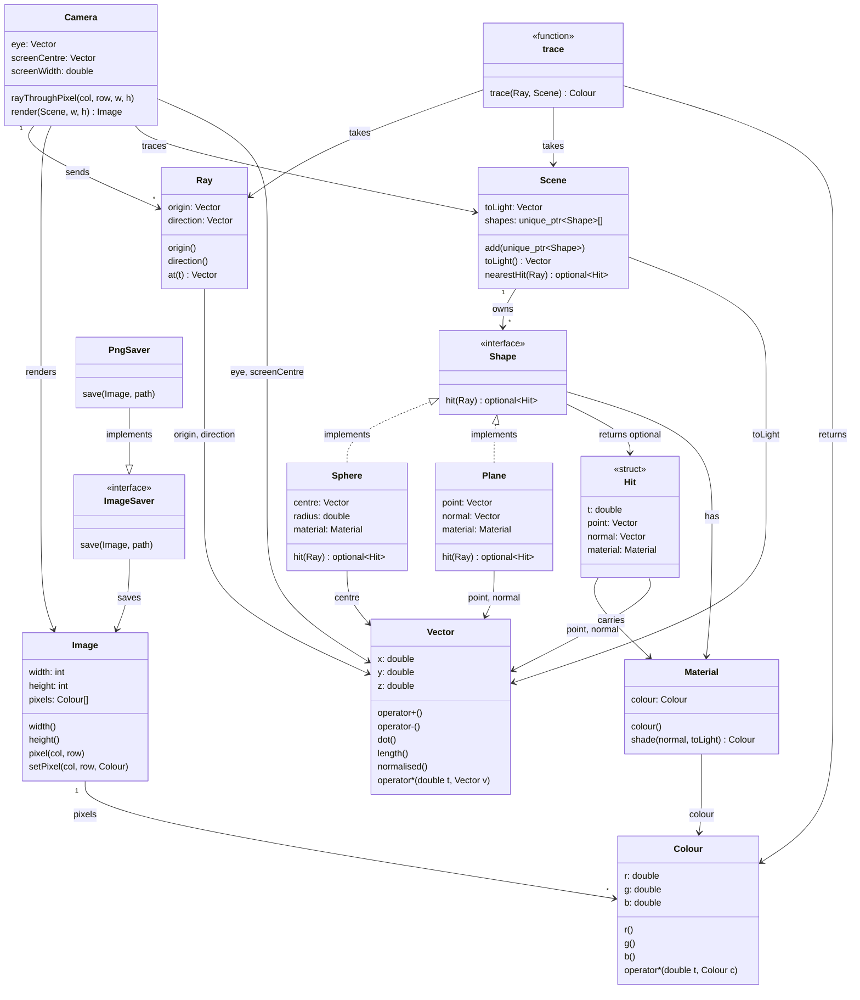

# Domain model

## The algorithm (in the client's words)

> We have a camera: an eye and a screen in front of it. The screen is divided into pixels. For each pixel, the camera sends a ray from the eye through the centre of the pixel. A ray has an origin and a direction, and both are vectors. We ask the scene for the nearest hit among its shapes (spheres, planes). Each shape has a material that computes how it is shaded by the sun's light using the surface normal. If the ray hits something, the pixel takes the shaded colour; otherwise, it takes the background colour. When every pixel has a colour, we have an image, and a saver writes it to a file.

## Class diagram



## Folder dependencies

The arrows between folders go one way (acyclic dependencies):

```
output/ ──→ image/ ──→ colour/
render/ ──→ image/
render/ ──→ scene/ ──→ geometry/ ──→ material/ ──→ colour/
              │            │             │
              └────────────┴─────────────┴──→ math/
```

## Open questions / parked decisions

| Topic | Note |
|---|---|
| Single directional sun in `Scene` | A lamp (point light) would be a second kind of light: introduce a Light interface when needed. |
| Single `Material` law (Lambertian) | Reflective or refractive materials (mirrors, glass) will require a `Material` abstraction or variant. |
| Each `Shape` stores `_material` | Three lines of plumbing per shape; revisit with the third shape. |
| No shadows yet | Dark sides are black from `max(0, N·L)`; cast shadow rays when shadows are requested. |
| `Camera` has two reasons to change | Holds camera geometry and the render loop. Split when scenes or distributed rendering require it. |
| Colour outside `[0, 1]` | `toByte` assumes values in `[0, 1]`. Decide clamping/tone-mapping when multiple lights arrive. |
| Out-of-bounds pixels in `Image` | No bounds check yet. Decide policy when needed. |
