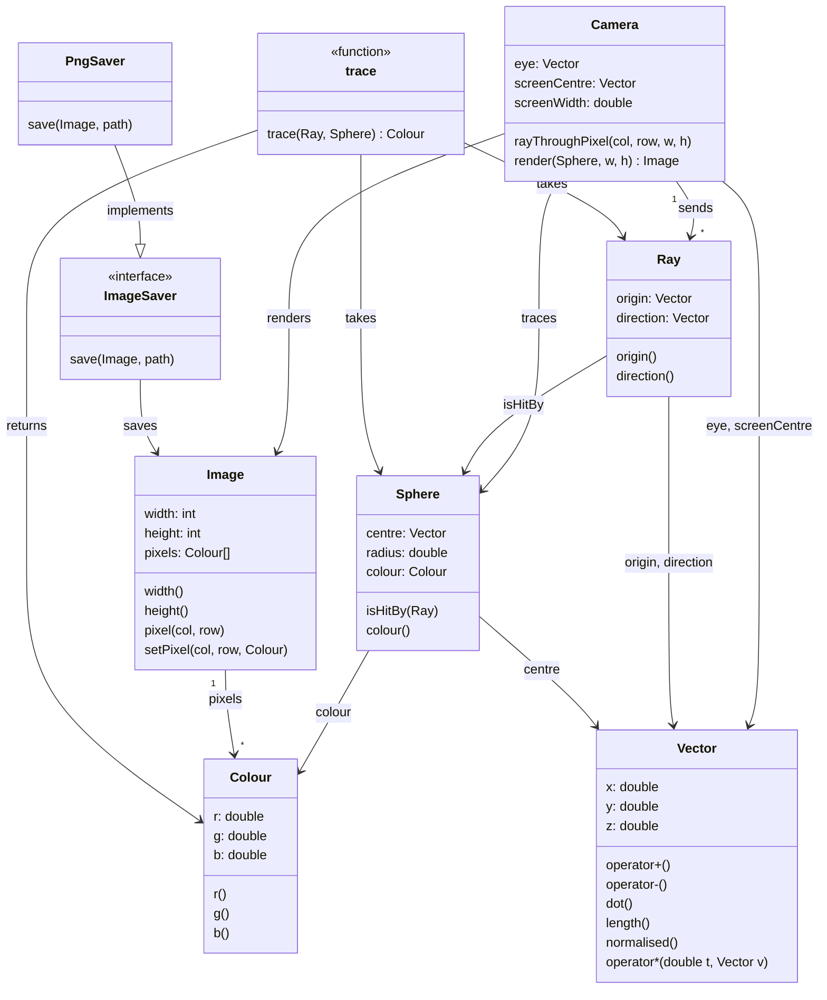

# Domain model

## The algorithm (in the client's words)

> We have a camera: an eye and a screen in front of it. The screen is divided into pixels. For each pixel, the camera sends a ray from the eye through the centre of the pixel. A ray has an origin and a direction, and both are vectors. We ask the sphere whether the ray hits it. A sphere has a centre, a radius and a colour. If the ray hits, the pixel takes the colour of the sphere. If not, it takes the colour of the sky. When every pixel has a colour, we have an image, and we save it to a file.

## Class diagram



## Folder dependencies

The arrows between folders go one way (acyclic dependencies):

```
output/ ──→ image/ ──→ colour/
render/ ──→ image/
render/ ──→ geometry/ ──→ math/
               │
               └────────→ colour/
```

## Open questions / parked decisions

| Topic | Note |
|---|---|
| `isHitBy` answers yes/no | With two spheres, we'll need the nearest `t`. Change when a test needs it. |
| Touching counts as a hit | Decided by `>= 0` in the discriminant check. Keep until it matters. |
| Eye inside the sphere | `t1 < 0` and `t2 > 0` counts as a hit. Keep until it matters. |
| `trace` and `render` take one concrete `Sphere` | O/D of SOLID for shapes arrive with the second shape. |
| `Camera` has two reasons to change | Holds camera geometry and the render loop. Split when scenes or distributed rendering require it. |
| Colour outside `[0, 1]` | `toByte` assumes values in `[0, 1]`. Decide clamping/tone-mapping when lights arrive. |
| Out-of-bounds pixels in `Image` | No bounds check yet. Decide policy when needed. |
